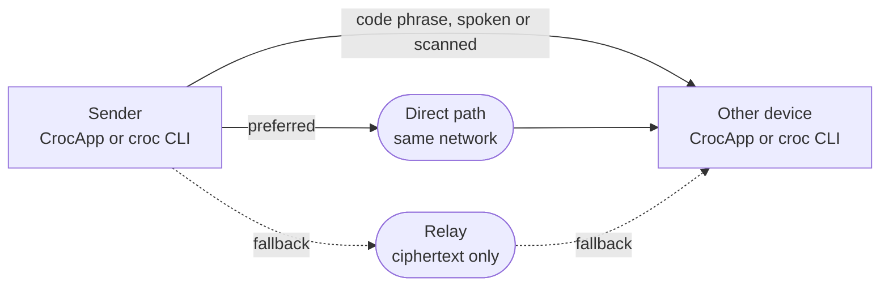
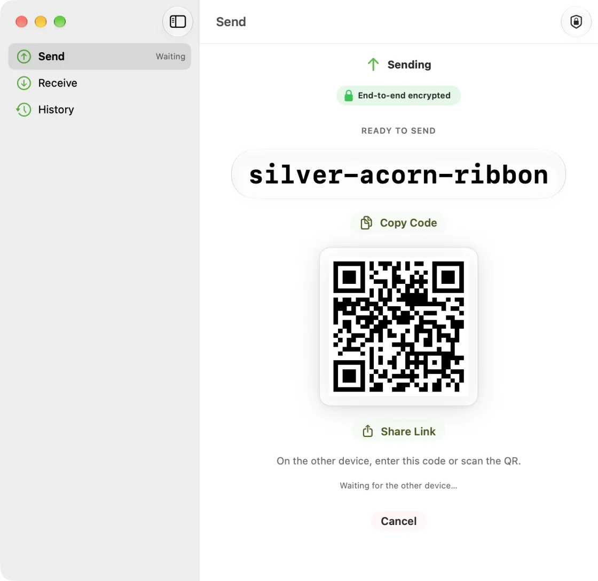
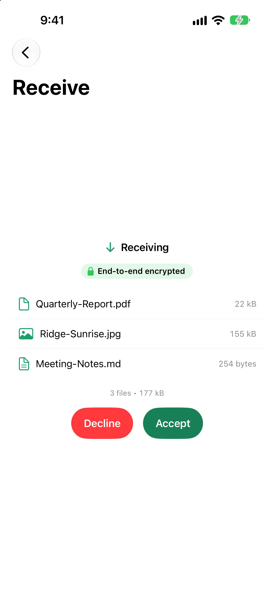
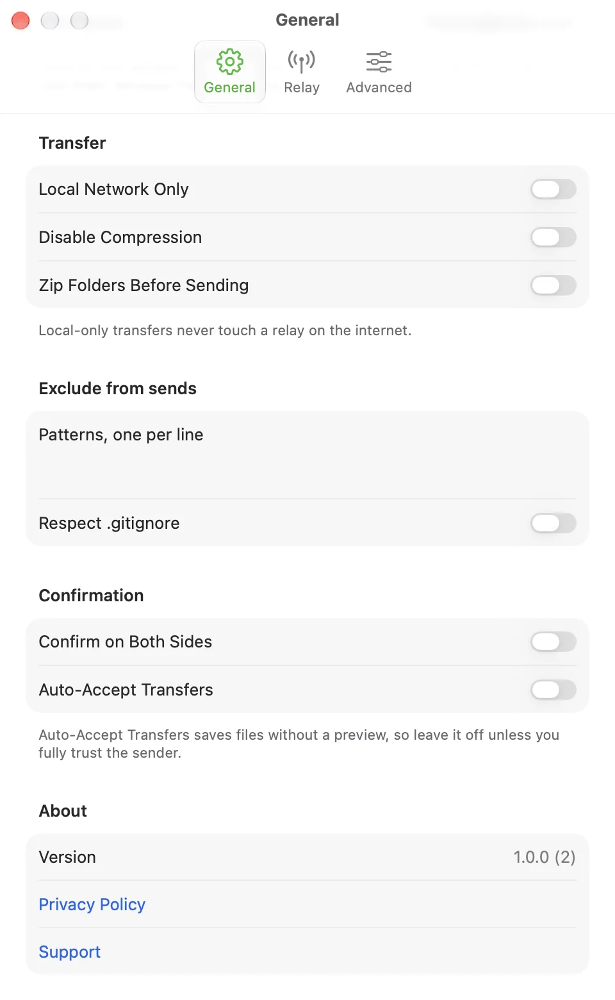

<h1 align="center">CrocApp</h1>

<p align="center">
  <strong>Send files with a code phrase</strong>
  <br>
  A free, open-source native SwiftUI app for Mac, with iPhone and iPad arriving in the App Store release.
</p>

<p align="center">
  <a href="https://github.com/bakirgdev/CrocApp/actions/workflows/ci.yml"></a>
  <a href="https://scorecard.dev/viewer/?uri=github.com/bakirgdev/CrocApp"></a>
  <a href="https://www.bestpractices.dev/projects/15633"></a>
  <a href="https://github.com/bakirgdev/CrocApp/releases/latest"></a>
  
  <a href="LICENSE"></a>
  <a href="https://crocapp.dev"></a>
</p>

## What it is

CrocApp sends files, folders, and text between two devices anywhere in the world, end-to-end encrypted, using a short code phrase like `apple-house-car`. No account and no shared network needed.

It is a graphical front end for [croc](https://github.com/schollz/croc), the command-line file-transfer tool by [Zack Scholl](https://github.com/schollz). CrocApp embeds croc's Go library rather than shelling out to the binary, so **a code phrase from the croc CLI works in the app, and the reverse**.

> [!NOTE]
> CrocApp is unofficial and not affiliated with or endorsed by croc's author.

## Download

| Platform | Where |
|---|---|
| iPhone, iPad, Mac (App Store) | Not listed yet; once live links will be posted |
| Mac (Apple silicon only) | `CrocApp-<version>-arm64.dmg` from [GitHub Releases](https://github.com/bakirgdev/CrocApp/releases/latest) |
| Mac (Homebrew cask) | Not available yet. Homebrew accepts a cask once the repo shows [enough public interest](https://docs.brew.sh/Package-Acceptance-Policy#notability): 225 stars, 90 watchers, or 90 forks. Starring the repo helps |

The disk image is Developer ID signed, notarized, and updates itself through Sparkle (**Check for Updates…** in the app menu). Verify it with `gh attestation verify <file> --repo bakirgdev/CrocApp` ([`SECURITY.md`](SECURITY.md)). Install guide: [crocapp.dev/docs/getting-started/install](https://crocapp.dev/docs/getting-started/install/). To check a download, see [Verify a release](https://crocapp.dev/docs/getting-started/verify-downloads/). Or [build from source](docs/BUILDING.md).

## How it works



1. The sender picks files, a folder, or text.
2. CrocApp shows a code phrase. Say it, message it, or show it as a QR code.
3. The other device enters the phrase, previews the file list, and accepts.

Both devices run PAKE over the code phrase to derive a session key, so the phrase never crosses the network in the clear and the relay never learns the key. CrocApp tries the local network and the relay at once; on the same network the transfer goes direct.

## Screenshots

<table>
  <tr>
    <td align="center" valign="top">
      <picture>
        <source media="(prefers-color-scheme: dark)" srcset="web/docs/screenshots/mac/send-code-dark.webp">
        
      </picture>
      <br><sub><strong>macOS</strong>: send, with code phrase and QR</sub>
    </td>
    <td align="center" valign="top">
      <picture>
        <source media="(prefers-color-scheme: dark)" srcset="web/docs/screenshots/iphone/receive-incoming-dark.webp">
        
      </picture>
      <br><sub><strong>iOS</strong>: receive, preview then accept</sub>
    </td>
  </tr>
  <tr>
    <td align="center" colspan="2">
      <picture>
        <source media="(prefers-color-scheme: dark)" srcset="web/docs/screenshots/mac/settings-dark.webp">
        
      </picture>
      <br><sub><strong>macOS</strong>: settings, with your own relay, local-only, compression</sub>
    </td>
  </tr>
</table>

## Security and privacy

Transfers are end-to-end encrypted, the code phrase authenticates both devices (PAKE), and the relay only ever sees ciphertext.

> [!WARNING]
> Neither croc nor CrocApp has had a formal third-party security audit.

- No accounts, analytics, ads, or tracking. The [privacy policy](https://crocapp.dev/privacy/) lists every server the app can contact.
- Transfer history stays on the device.
- You can use your own croc relay instead of the default public ones.
- Report vulnerabilities privately through [GitHub Security Advisories](https://github.com/bakirgdev/CrocApp/security/advisories/new), never in a public issue. See [`SECURITY.md`](SECURITY.md). The threat model and trust boundaries are in [`docs/THREAT-MODEL.md`](docs/THREAT-MODEL.md).

## Features

<details>
<summary><strong>Core transfer</strong></summary>

| Feature | croc equivalent |
|---|---|
| Send files, multiple at once, drag-drop or picker | positional args |
| Send folders | positional args |
| Send text and clipboard contents | `--text` |
| Receive by code phrase | positional args |
| Custom code phrase | `--code` |
| Show QR on send, scan QR on receive | `--qrcode` |
| Choose output folder; Files-visible by default on iOS | `--out` |
| Keep Both or Replace when a file already exists; resume with Replace | `--rename`, `--overwrite` |
| Preview the file list, then accept or decline | interactive prompt |
| Live progress, speed, cancel; Live Activity on iOS | |
| Local network and relay raced automatically | croc default |
| Local transfer history | |

</details>

<details>
<summary><strong>Power options</strong></summary>

| Feature | croc equivalent |
|---|---|
| Custom relay, password, IPv6 | `--relay --relay6 --pass` |
| Force local-only transfers | `--local` |
| Disable compression | `--no-compress` |
| Zip a folder before sending | `--zip` |
| Exclude patterns, respect `.gitignore` | `--exclude --git` |
| Auto-accept transfers, off by default | `--yes` |
| Require confirmation on both sides | `--ask` |

</details>

<details>
<summary><strong>Advanced settings</strong></summary>

| Feature | croc equivalent |
|---|---|
| SOCKS5 proxy | `--socks5` |
| HTTP proxy | `--connect` |
| Send speed limit | `--throttleUpload` |
| Sender IP, direct connect | `--ip` |
| Multicast address | `--multicast` |
| Skip the local network | `--no-local` |
| Single connection | `--no-multi` |
| Built-in DNS resolver | `--internal-dns` |
| Exclude exact paths | `--exclude-file` |

</details>

<details>
<summary><strong>Native to the app</strong></summary>

| Feature |
|---|
| Share extension: send from any app (iOS) |
| Menu bar quick send and Open at login (macOS) |
| Receive links: `crocapp://`, `crocapp.dev/r/` and `getcroc.com/?code=` open Receive with the code filled in |
| Shortcuts and Siri actions: Send Files, Send Text, Receive |
| Trust UI: end-to-end badge, **How It Works**, active-relay indicator |
| Share Link and a QR code that opens CrocApp or a page that explains how to receive |
| Send as Link: files encrypted on your device, for someone who is not online, with expiry and revoke |
| iPad File menu: Show Receive Folder in Files |

</details>

## FAQ

<details>
<summary><strong>How is this different from AirDrop?</strong></summary>

AirDrop needs two Apple devices close to each other. CrocApp works between any two devices running croc or CrocApp, on any network, at any distance, for example from an iPhone to a Linux server on another continent.

</details>

<details>
<summary><strong>Does it work with the croc CLI?</strong></summary>

Yes, in both directions. CrocApp embeds croc, so `croc send` on a laptop can be received in the app on a phone, and the reverse. The CLI must be croc 11 or newer.

</details>

<details>
<summary><strong>Why iOS 26 and macOS 26 (or newer) only?</strong></summary>

It lets the app use current SwiftUI APIs and Liquid Glass without availability checks everywhere. The minimum is 26.0, so every 26.x (or newer) release works.

</details>

<details>
<summary><strong>Is it free? Will it ever have a paid tier?</strong></summary>

Free and MIT-licensed, and it stays that way. Donations are welcome but optional, see [Support the project](#support-the-project).

</details>

<details>
<summary><strong>Will there be a Windows, Linux, or Android version?</strong></summary>

Not planned yet. If you want to see CrocApp on other platforms, show your interest in an [issue](https://github.com/bakirgdev/CrocApp/issues).

</details>

## Build from source

You need a Mac with macOS 26 or newer, Xcode and Go ([exact versions](docs/BUILDING.md#prerequisites)).

```bash
git clone https://github.com/bakirgdev/CrocApp.git
cd CrocApp
scripts/build-xcframework.sh   # builds the Go engine into CrocKit/Croc.xcframework
open app/CrocApp.xcodeproj     # run the CrocApp scheme
```

Signing, tests and the transfer harnesses: [`docs/BUILDING.md`](docs/BUILDING.md).

## Project layout

| Path | What it holds |
|---|---|
| `app/` | The SwiftUI app for iPhone, iPad and Mac, its share extension, the direct-download target and the unit tests |
| `CrocKit/` | Swift package that wraps the Go engine in a Swift API |
| `crocmobile/` | Go wrapper around croc, bound by gomobile into `Croc.xcframework` |
| `design/` | Design principles and tokens for every surface |
| `docs/` | Contributor docs: architecture, building, releasing, threat model |
| `web/landing/`, `web/docs/` | The crocapp.dev landing page and docs site |
| `scripts/` | Build, verification and release scripts |
| `assets/` | Icon source, mascot, favicons, disk image background and social preview |

## Docs

| Read | For |
|---|---|
| [crocapp.dev/docs](https://crocapp.dev/docs/) | Using the app |
| [`CONTRIBUTING.md`](CONTRIBUTING.md) | Setup, conventions and opening a pull request |
| [`docs/README.md`](docs/README.md) | Index of the contributor docs |
| [`docs/ARCHITECTURE.md`](docs/ARCHITECTURE.md) | How the layers fit together |
| [`docs/THREAT-MODEL.md`](docs/THREAT-MODEL.md) | Trust boundaries and what CrocApp defends against |
| [`CHANGELOG.md`](CHANGELOG.md) | What changed in each release |

## Contributing

Pull requests are welcome: bugs, features, docs, design, landing page. Start with [`CONTRIBUTING.md`](CONTRIBUTING.md) for setup, commit conventions, design rules, etc. Questions and ideas go to [Discussions](https://github.com/bakirgdev/CrocApp/discussions). Everyone follows the [Code of Conduct](CODE_OF_CONDUCT.md). How decisions are made: [`GOVERNANCE.md`](GOVERNANCE.md). Where the project is headed: [`docs/ROADMAP.md`](docs/ROADMAP.md).

## Support the project

CrocApp does not depend on donations: it has no paid tier and no features behind a paywall. If it saves you time and you want to give back, donations are welcome:

- [GitHub Sponsors](https://github.com/sponsors/bakirgdev): one-time or monthly, also behind the **Sponsor** button at the top of this repo.
- [Buy Me a Coffee](https://buymeacoffee.com/bakirgdev): one-time.

Starring the repo, reporting bugs, and telling others about CrocApp help just as much.

## Credits and license

- [croc](https://github.com/schollz/croc) by [Zack Scholl](https://github.com/schollz), the transfer engine that makes this possible. MIT.
- CrocApp by [Bakir Gracić](https://github.com/bakirgdev). [MIT](LICENSE).
