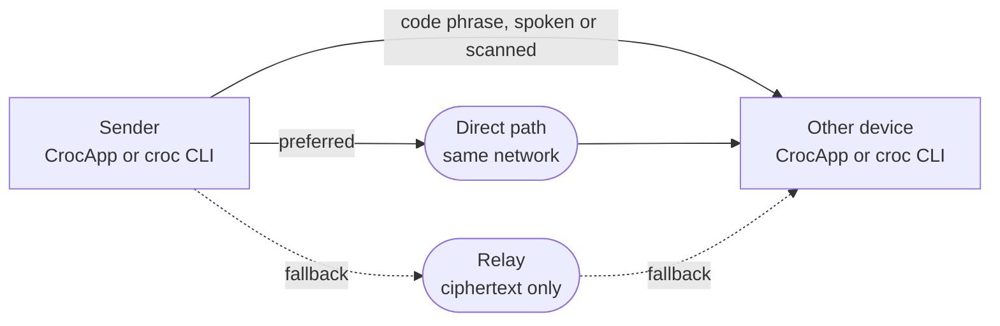
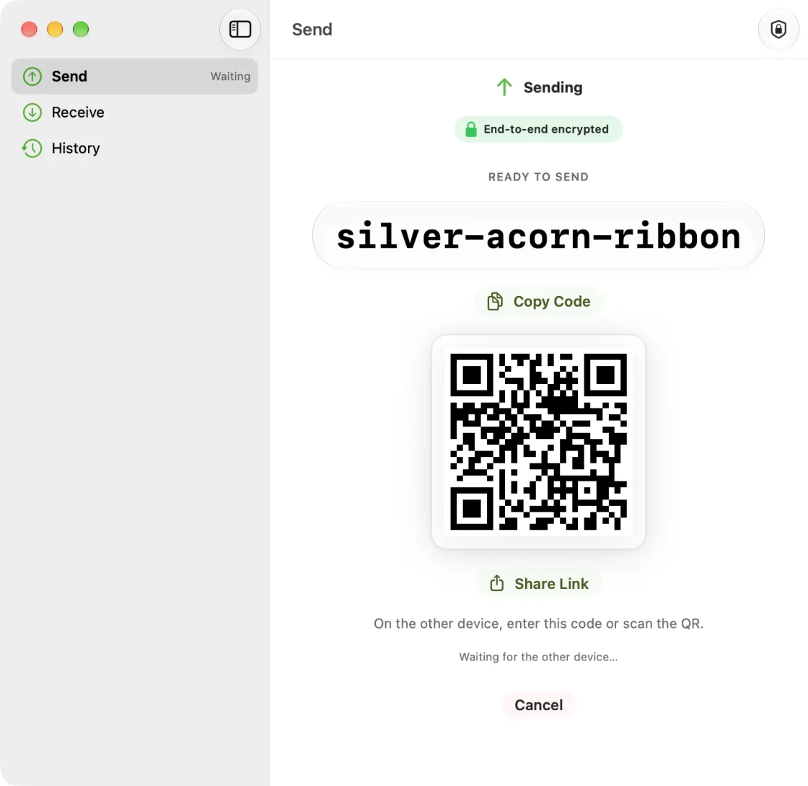
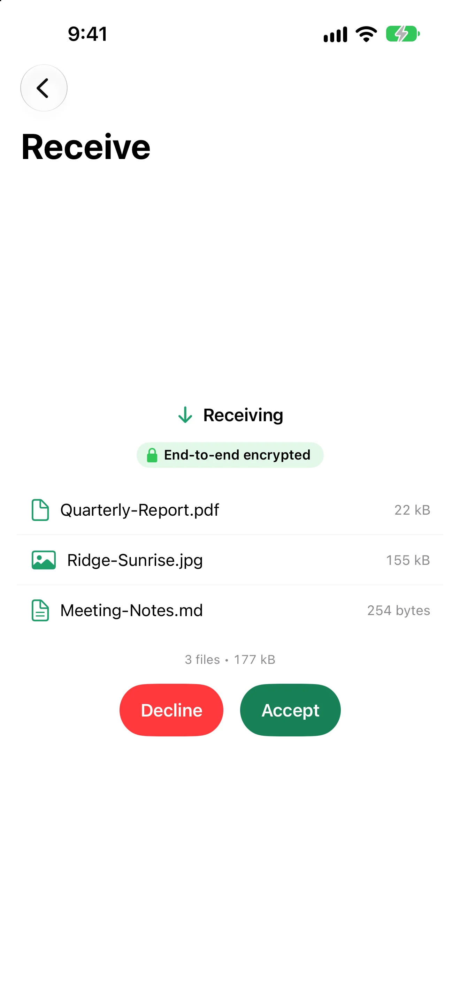
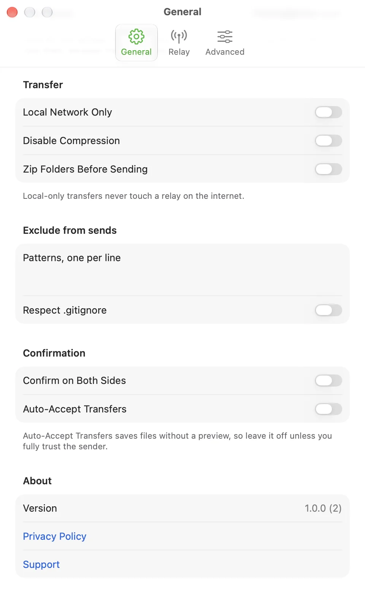

<h1 align="center">CrocApp</h1>

<p align="center">
  <strong>Send files with a code phrase</strong>
  <br>
  A free, open-source native SwiftUI app for iPhone, iPad and Mac.
</p>

<p align="center">
  <a href="https://github.com/bakirgdev/CrocApp/actions/workflows/ci.yml"></a>
  <a href="https://scorecard.dev/viewer/?uri=github.com/bakirgdev/CrocApp"></a>
  <a href="https://www.bestpractices.dev/projects/15633"></a>
  <a href="https://github.com/bakirgdev/CrocApp/releases/latest"></a>
  
  <a href="LICENSE"></a>
  <a href="https://crocapp.dev"></a>
</p>

## What it is

CrocApp sends files, folders, and text between two devices anywhere in the world, end-to-end encrypted, using a short code phrase like `apple-house-car`. No account and no shared network needed.

It is a graphical front end for [croc](https://github.com/schollz/croc), the command-line file-transfer tool by [Zack Scholl](https://github.com/schollz). CrocApp embeds croc's Go library rather than shelling out to the binary, so **a code phrase from the croc CLI works in the app, and the reverse**.

> [!NOTE]
> CrocApp is unofficial and not affiliated with or endorsed by croc's author.

## Download

| Platform | Where |
|---|---|
| iPhone, iPad, Mac (App Store) | [CrocApp on the App Store](https://apps.apple.com/app/crocapp/id6805675003) |
| Mac (Apple silicon only) | `CrocApp-<version>-arm64.dmg` from [GitHub Releases](https://github.com/bakirgdev/CrocApp/releases/latest) |
| Mac (Homebrew cask) | Not available yet. Homebrew accepts a cask once the repo shows [enough public interest](https://docs.brew.sh/Package-Acceptance-Policy#notability): 225 stars, 90 watchers, or 90 forks. Starring the repo helps |

The disk image is Developer ID signed, notarized, and updates itself through Sparkle (**Check for Updates…** in the app menu). Verify it with `gh attestation verify <file> --repo bakirgdev/CrocApp` ([`SECURITY.md`](SECURITY.md)). Install guide: [crocapp.dev/docs/getting-started/install](https://crocapp.dev/docs/getting-started/install/). To check a download, see [Verify a release](https://crocapp.dev/docs/getting-started/verify-downloads/). Or [build from source](docs/BUILDING.md).

## How it works



1. The sender picks files, a folder, or text.
2. CrocApp shows a code phrase. Say it, message it, or show it as a QR code.
3. The other device enters the phrase, previews the file list, and accepts.

Both devices run PAKE over the code phrase to derive a session key, so the phrase never crosses the network in the clear and the relay never learns the key. CrocApp tries the local network and the relay at once; on the same network the transfer goes direct.

## Screenshots

<table>
  <tr>
    <td align="center" valign="top">
      <picture>
        <source media="(prefers-color-scheme: dark)" srcset="web/docs/screenshots/mac/send-code-dark.webp">
        
      </picture>
      <br><sub><strong>macOS</strong>: send, with code phrase and QR</sub>
    </td>
    <td align="center" valign="top">
      <picture>
        <source media="(prefers-color-scheme: dark)" srcset="web/docs/screenshots/iphone/receive-incoming-dark.webp">
        
      </picture>
      <br><sub><strong>iOS</strong>: receive, preview then accept</sub>
    </td>
  </tr>
  <tr>
    <td align="center" colspan="2">
      <picture>
        <source media="(prefers-color-scheme: dark)" srcset="web/docs/screenshots/mac/settings-dark.webp">
        
      </picture>
      <br><sub><strong>macOS</strong>: settings, with your own relay, local-only, compression</sub>
    </td>
  </tr>
</table>

## Security and privacy

Transfers are end-to-end encrypted, the code phrase authenticates both devices (PAKE), and the relay only ever sees ciphertext.

> [!WARNING]
> Neither croc nor CrocApp has had a formal third-party security audit.

- No accounts, analytics, ads, or tracking. The [privacy policy](https://crocapp.dev/privacy/) lists every server the app can contact.
- Transfer history stays on the device.
- You can use your own croc relay instead of the default public ones.
- Report vulnerabilities privately through [GitHub Security Advisories](https://github.com/bakirgdev/CrocApp/security/advisories/new), never in a public issue. See [`SECURITY.md`](SECURITY.md). The threat model and trust boundaries are in [`docs/THREAT-MODEL.md`](docs/THREAT-MODEL.md).

## Build from source

You need a Mac with macOS 26 or newer, Xcode and Go ([exact versions](docs/BUILDING.md#prerequisites)).

```bash
git clone https://github.com/bakirgdev/CrocApp.git
cd CrocApp
scripts/build-xcframework.sh   # builds the Go engine into CrocKit/Croc.xcframework
open app/CrocApp.xcodeproj     # run the CrocApp scheme
```

Signing, tests and the transfer harnesses: [`docs/BUILDING.md`](docs/BUILDING.md).

## More

[Documentation](https://crocapp.dev/docs/) (guides and the [FAQ](https://crocapp.dev/docs/faq/)), [`CONTRIBUTING.md`](CONTRIBUTING.md), [`CHANGELOG.md`](CHANGELOG.md), the [contributor docs](docs/README.md) and the [threat model](docs/THREAT-MODEL.md). Questions and ideas go to [Discussions](https://github.com/bakirgdev/CrocApp/discussions), and everyone follows the [Code of Conduct](CODE_OF_CONDUCT.md). CrocApp has no paid tier; donations through [GitHub Sponsors](https://github.com/sponsors/bakirgdev) or [Buy Me a Coffee](https://buymeacoffee.com/bakirgdev) are optional, and so is starring the repo.

## Credits and license

- [croc](https://github.com/schollz/croc) by [Zack Scholl](https://github.com/schollz), the transfer engine that makes this possible. MIT.
- CrocApp by [Bakir Gracić](https://github.com/bakirgdev). [MIT](LICENSE).
- Projects that inspired CrocApp:
  - [magic-wormhole](https://github.com/magic-wormhole/magic-wormhole): the original code-phrase transfer, and croc's own inspiration.
  - [LocalSend](https://github.com/localsend/localsend): proof that a cross-platform transfer app can be genuinely pleasant to use.
  - [croc-app](https://github.com/Dking08/croc-app): the Android client, and the best mobile reference for what a croc GUI should feel like.
  - [crock](https://github.com/KD-MM2/crock): a desktop croc GUI, and where the QR deeplink idea comes from.
  - [crocgui](https://github.com/howeyc/crocgui): the long-running cross-platform croc GUI.
